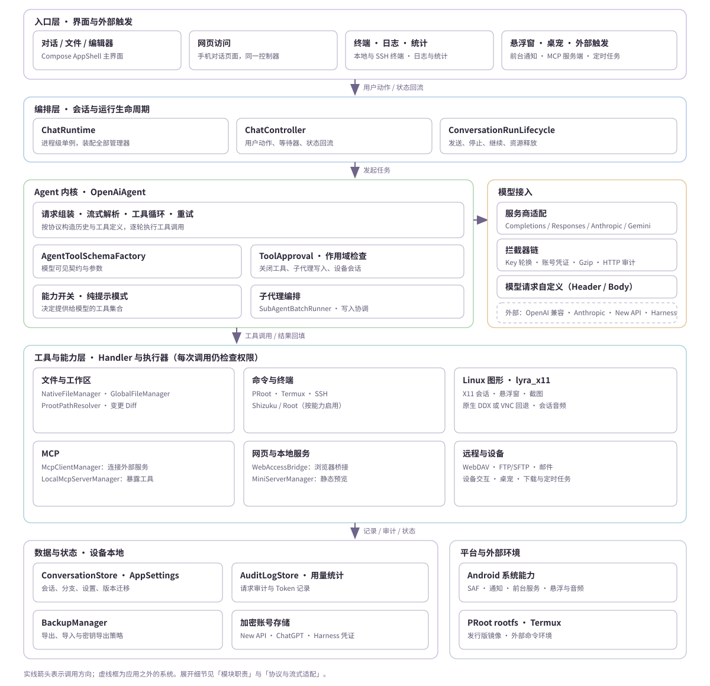

# 架构与请求链路

目标：沿一次用户任务找到正确修改层。应用主体是 Kotlin/Jetpack Compose 的 Android `app` 模块；`third_party/jlatexmath` 作为库模块参与构建。



## 分层视图

上图按调用方向分层。箭头从入口指向编排与 Agent，再分派到工具与能力层；数据层记录结果，平台层提供实际执行能力。虚线框属于应用之外的系统。

| 层 | 主要源码 | 负责什么 |
| --- | --- | --- |
| 入口层 | `ui/app/`、`ui/chat/`、`ui/settings/`、`webaccess/`、`interaction/overlay/` | Compose 页面、网页入口、悬浮窗、桌宠与通知 |
| 编排层 | `ChatRuntime.kt`、`ChatController.kt`、`ConversationRunLifecycle.kt` | 进程装配、用户动作、等待器与运行生命周期 |
| Agent 内核 | `ai/agent/OpenAiAgent.kt`、`AgentToolSchemaFactory.kt`、`SubAgent*` | 请求循环、工具分派、审批与子代理 |
| 模型接入 | `ai/`（拦截器、审计、缓存）、`ProviderCatalog.kt` | 协议适配、凭证注入、重试、响应缓存 |
| 工具与能力层 | `ai/agent/Agent*Handler`、`workspace/`、`termux/`、`ssh/`、`system/`、`mcp/`、`server/`、`email/`、`webdav/`、`filetransfer/`、`interaction/`、`:lyra_x11` | 工具实现与各执行器，调用时仍检查权限 |
| 数据与状态 | `data/ConversationStore.kt`、`data/settings/`、`BackupManager.kt`、`AuditLogStore.kt`、`UsageStatistics.kt` | 会话、分支、配置、备份、审计与用量 |
| 平台与外部 | `app/src/debianRuntime/`、`:lyra_x11`、Android 权限与前台服务 | PRoot 运行时、图形会话、系统能力与远端服务 |

同一功能通常跨多层：例如「读取工作区文件」由入口层触发、Agent 分派、`AgentFileToolHandler` 与 `NativeFileManager` 执行、`ConversationStore` 记录结果。改动应落在对应层，而不是在 UI 里直接做 IO。

## 一次任务如何完成

```text
Compose / 网页访问 / 悬浮入口
  → ChatController 与会话生命周期
  → OpenAiAgent 的请求与工具循环
  → 协议适配 → 模型返回文字或工具调用
  → 能力/作用域检查 → 审批 → Tool Handler / 执行器
  → 结构化结果、文件 Diff、状态回流
  → 下一轮模型请求或任务结束
```

文字回复和真实工具调用是不同事件。新增执行行为应进入执行层与结果链路，不能只修改提示词或 UI 卡片。

## 源码地图

以下路径相对于 `app/src/main/java/com/yukisoffd/lyracode/`。

| 层 | 主要入口 | 负责什么 |
| --- | --- | --- |
| 应用/UI | `MainActivity.kt`、`ui/app/`、`ui/chat/`、`ui/settings/` | 导航、会话与设置界面 |
| 会话编排 | `ChatController.kt`、`ConversationRunLifecycle.kt` | 用户动作、运行状态和生命周期 |
| Agent | `ai/agent/OpenAiAgent.kt` | 模型循环、协议请求、工具分派和审批连接 |
| 工具 | `ai/agent/AgentToolSchemaFactory.kt`、各 `Agent*ToolHandler.kt` | 参数定义与领域操作 |
| 持久化 | `data/ConversationStore.kt`、`data/settings/`、`data/BackupManager.kt` | 会话、配置、备份 |
| 文件与命令 | `workspace/`、`termux/`、`ssh/`、`system/` | 路径、IO、终端和系统执行 |
| 服务 | `mcp/`、`webaccess/`、`server/` | MCP、手机对话网页与静态服务 |
| 设备交互 | `interaction/` | 感知、策略、操作、会话、悬浮入口和桌宠 |

PRoot 管理器、架构识别、执行器和工具定义在 `app/src/debianRuntime/java/`，并非普通 `main/java` 目录。

## 需要保留的边界

`AgentToolSchemaFactory` 决定模型可见定义；`executeTool` 仍检查关闭工具、子代理权限、设备会话和审批。只过滤 schema 不能替代执行时检查。

工作区修改通过专用文件链路记录前后内容和 Diff。普通 IO 绕过它会导致审查记录不完整。设备交互使用会话作用域工具，不应借 Shell、MCP 或子代理扩展到未授权能力。

网页访问共用 Activity 的现有控制器与数据，不创建第二个 Agent 会话系统。改状态时要考虑手机、网页、悬浮入口的同步与生命周期。

扩展一个具体功能时，先沿现有同类实现定位，再阅读对应[工具](/developer/agent-tools)、[协议](/developer/providers)或[工作区](/developer/workspaces)章节。

## 按问题进入细节

### 结构与依赖

[模块职责](/developer/modules)区分工程模块、源码集和应用内部层次，列出 Handler 分工和资源所有者；[数据模型](/developer/persistence)说明会话、消息、分支、归档与迁移。

### 生命周期与接口

[会话生命周期](/developer/conversation-lifecycle)说明发送、流读取、停止、继续和旧回调隔离；[钩子接口](/developer/hooks)列出真实回调签名、线程与编辑器接管返回语义。

### 多入口共用能力

[网页桥接](/developer/web-access)通过同一控制器同步状态，[MCP 服务端](/developer/mcp)通过工具定义与专用执行入口暴露能力；两者的会话身份与审批行为需分别考虑。桌宠 JS 使用独立的[模块生命周期](/developer/pet-runtime)。
