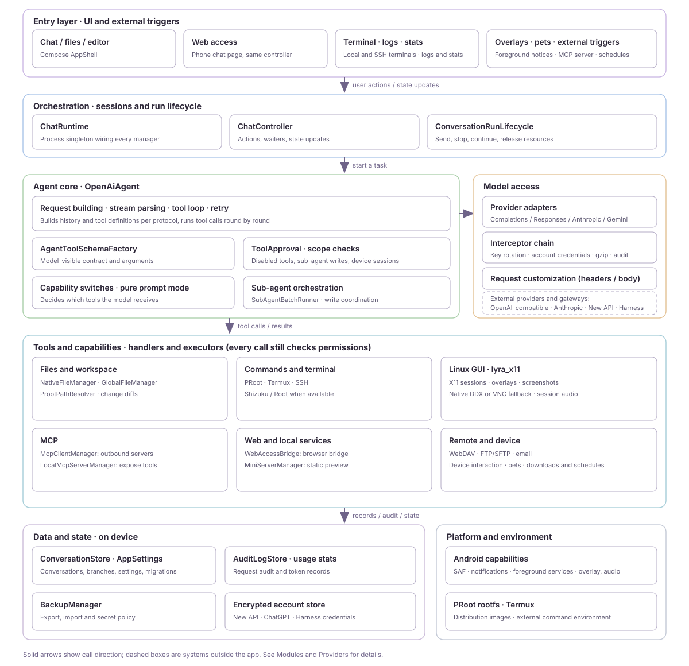

# Architecture and request flow

Goal: locate the right layer for a change by following one task. The main Android `app` module uses Kotlin and Jetpack Compose; `third_party/jlatexmath` is included as a library module.



## Layered view

The diagram follows call direction: entries reach orchestration and the Agent, which dispatches into tools and capabilities; the data layer records results and the platform layer supplies real execution. Dashed boxes are systems outside the app.

| Layer | Main source | Responsibility |
| --- | --- | --- |
| Entry | `ui/app/`, `ui/chat/`, `ui/settings/`, `webaccess/`, `interaction/overlay/` | Compose screens, web entry, floating window, pets and notifications |
| Orchestration | `ChatRuntime.kt`, `ChatController.kt`, `ConversationRunLifecycle.kt` | Process wiring, user actions, waiters and run lifecycle |
| Agent core | `ai/agent/OpenAiAgent.kt`, `AgentToolSchemaFactory.kt`, `SubAgent*` | Request loop, tool dispatch, approvals and sub-agents |
| Model access | `ai/` (interceptors, audit, cache), `ProviderCatalog.kt` | Protocol adapters, credential injection, retry, response cache |
| Tools and capabilities | `ai/agent/Agent*Handler`, `workspace/`, `termux/`, `ssh/`, `system/`, `mcp/`, `server/`, `email/`, `webdav/`, `filetransfer/`, `interaction/`, `:lyra_x11` | Tool implementations and executors, with permission checks at call time |
| Data and state | `data/ConversationStore.kt`, `data/settings/`, `BackupManager.kt`, `AuditLogStore.kt`, `UsageStatistics.kt` | Conversations, branches, settings, backup, audit and usage |
| Platform and external | `app/src/debianRuntime/`, `:lyra_x11`, Android permissions and foreground services | PRoot runtime, GUI sessions, system capabilities and remote services |

One feature usually spans several layers: reading a workspace file is triggered by the entry layer, dispatched by the Agent, executed by `AgentFileToolHandler` with `NativeFileManager`, and recorded through `ConversationStore`. Changes belong in the matching layer rather than performing IO directly in the UI.

## Request flow

```text
Compose / web access / floating entry
  → ChatController and conversation lifecycle
  → OpenAiAgent request and tool loop
  → Protocol adapter → model text or tool call
  → Capability/scope checks → approval → Handler/executor
  → Structured result, file diff and state updates
  → Next model round or completion
```

Text responses and actual tool calls are separate events. Execution features need execution and result handling, beyond prompt or UI changes.

## Source map

Paths below are relative to `app/src/main/java/com/yukisoffd/lyracode/`.

| Layer | Entry points | Responsibility |
| --- | --- | --- |
| Application/UI | `MainActivity.kt`, `ui/app/`, `ui/chat/`, `ui/settings/` | Navigation, conversations, settings |
| Conversation | `ChatController.kt`, `ConversationRunLifecycle.kt` | User actions, state, lifecycle |
| Agent | `ai/agent/OpenAiAgent.kt` | Model loop, protocol requests, dispatch and approvals |
| Tools | `ai/agent/AgentToolSchemaFactory.kt`, `Agent*ToolHandler.kt` | Definitions and domain operations |
| Persistence | `data/ConversationStore.kt`, `data/settings/`, `data/BackupManager.kt` | Chats, configuration, backup |
| Files/commands | `workspace/`, `termux/`, `ssh/`, `system/` | Paths, IO, terminal and system execution |
| Services | `mcp/`, `webaccess/`, `server/` | MCP, phone chat access and static serving |
| Device interaction | `interaction/` | Perception, policy, actions, sessions, overlays and pets |

PRoot managers, architecture detection, executors and tool definitions live under `app/src/debianRuntime/java/`.

## Preserve boundaries

`AgentToolSchemaFactory` determines model-visible definitions; `executeTool` still checks disabled tools, sub-agent permissions, device sessions and approvals. Schema filtering is not a substitute for execution-time checks.

Workspace mutations use the file pipeline to record before/after content and diffs. Direct IO bypasses review evidence. Device tools are scoped to their session and must not escape through Shell, MCP or sub-agents.

Web access shares the Activity's controller and data rather than creating a separate Agent system. Consider phone, browser and floating-entry synchronization when changing state or lifecycle.

Continue with [Agent tools](/en/developer/agent-tools), [Providers](/en/developer/providers) or [Workspaces](/en/developer/workspaces).

## Detailed reading paths

### Structure and dependencies

[Modules](/en/developer/modules) distinguishes Gradle/source-set/application layers, Handlers and resource owners. [Persistence](/en/developer/persistence) describes conversations, messages, branches, archive and migrations.

### Lifecycles and contracts

[Conversation lifecycle](/en/developer/conversation-lifecycle) covers sending, reads, stops, continuation and stale callbacks. [Hooks](/en/developer/hooks) provides actual signatures, threading and editor ownership results.

### Shared capabilities across entry points

[Web access](/en/developer/web-access) uses the controller for state sync; [MCP](/en/developer/mcp) exposes definitions and a dedicated execution entry. Consider session identity and approval behavior separately. Pet JS has its own [module lifecycle](/en/developer/pet-runtime).
